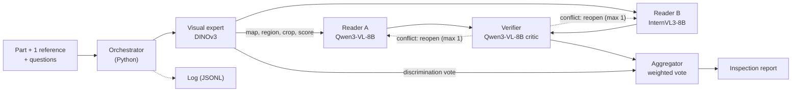
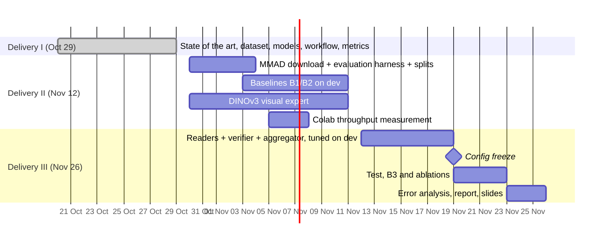

# OneRef: multi-agent system for industrial visual inspection from a single reference (IA025 Final Project)

October 2026 · Peter Angel Junnior Roque Vilchez and Charles Maxime Doudy

**Proposal:** a training-free multi-agent system built from open pre-trained models of at most 8B parameters. It inspects industrial parts from one photo and a single normal reference. We validate it on the MMAD benchmark against two baselines:
- the best single model (Qwen3-VL-8B, 73.91 %);
- a majority vote at the same compute cost.

| Item | Decision |
| --- | --- |
| Course topic | Multi-agent systems / agent orchestration, with pre-trained models and validation of results |
| Application | Visual quality control on a production line, with product changeovers and no retraining |
| Agents | Orchestrator, visual expert (DINOv3), 2 MLLM readers from different families, verifier, aggregator |
| Data | MMAD (ICLR 2025): 8,366 images, 39,670 questions, 7 subtasks, 4 sources (MVTec AD, VisA, MVTec LOCO, GoodsAD) |
| Validation | Per-subtask accuracy, false positives, McNemar + bootstrap, per-agent ablations, error analysis with MAST |
| Contribution | Measure how much of the reported multi-agent gain (SiGMA, 85.2 %) survives with a single reference and no tuning on the benchmark |

## 1. Critical review of the attached paper

The paper by Adimulam, Gupta and Kumar (Skan AI, arXiv 2601.13671, January 2026) is our **conceptual framework**, not experimental evidence. It is a 7-page position paper with no experiments, no dataset and no metrics of its own.

**What it contributes, and what we take from it:**

- **A taxonomy of specialized agents:**
  - *worker agents*, which execute subtasks;
  - *service agents*, for quality control, diagnosis and recovery;
  - *support agents*, for monitoring and analytics.
- **An orchestration layer.** This is the "control plane" that coordinates the agents. It has four units: planning and policies, execution and control, state and knowledge, and quality and operations.
- **Two communication protocols:**
  - **MCP** (Model Context Protocol), a standard for an agent to call external tools and data;
  - **A2A** (Agent-to-Agent), a standard for agents to delegate tasks to each other.
- **The central idea we adopt as a hypothesis:** reliability comes from orchestration and from **validating outputs against a schema**, not only from each agent's ability. Schema validation means checking that a response has the expected format and fields.

**Limitations to keep in mind when citing it:**

- **No empirical validation.** The case studies ("95 % precision", "20× faster", "80 % lower cost") come from blogs and consulting reports (Multimodal.dev, McKinsey), not controlled experiments.
- **Several references have wrong authors.** Checked against arXiv:
  - [5] Agent Laboratory is by [Schmidgall et al. (AMD/JHU)](https://arxiv.org/abs/2501.04227), not "Deng et al.".
  - [6] AgentCoder is by [Huang et al. (HKU)](https://arxiv.org/abs/2312.13010), not "Luo et al.".
  - [8] KoMA is by [Jiang et al. (Beihang)](https://arxiv.org/abs/2407.14239), not "Zhao et al.".
  - [9] (arXiv 2402.01680) is actually the survey by [Guo et al.](https://arxiv.org/abs/2402.01680), under a different title.
  
  The final report should cite the original sources directly, not this paper as an intermediary.
- **Enterprise focus, not research.** It does not compare architectures (centralized, debate, hierarchical). It also never discusses cases where a multi-agent system does **not** beat a single well-used model.

**Takeaway for the project:** we use its architecture (roles + orchestrator + validation) as a design template. We then add what it lacks: a measurable experiment on a public dataset, with baselines and ablations.

## 2. State of the art

Multi-agent systems beat a single model only when the roles are complementary and there is real **verification**. In industrial inspection the bottleneck is **fine-grained perception** of the defect, not reasoning. That is why the best 2025–2026 systems combine MLLMs (multimodal large language models, i.e. language models that also see images) with a "visual expert" that compares the part against a normal reference.

### 2.1 Foundations: LLM agents and orchestration patterns

- **Reference survey.** [Guo et al. (2024)](https://arxiv.org/abs/2402.01680) classify LLM-based multi-agent systems by agent profile, communication and improvement mechanisms, and list the field's benchmarks.
- **Practical patterns.** [Anthropic (2024), "Building effective agents"](https://www.anthropic.com/research/building-effective-agents) separates two kinds of system:
  - *workflows*, a fixed flow defined in code;
  - *agents*, where the model decides the next step.
  
  It describes five patterns: prompt chaining, routing, parallelization (sectioning or voting), orchestrator–workers, and evaluator–optimizer. Its central advice: start with the simplest solution and add agents only when they improve a metric.
- **Multi-agent debate.** In [Du et al. (ICML 2024)](https://arxiv.org/abs/2305.14325), several LLM instances propose answers, critique each other's and converge over rounds. This improves reasoning and factuality over a single model.
- **Verification as a role.** [AgentCoder (Huang et al.)](https://arxiv.org/abs/2312.13010) separates programmer, test designer and test executor. With GPT-4 it reaches 96.3 % pass@1 on HumanEval, using fewer tokens than MetaGPT or ChatDev. The lesson: an agent that **verifies with external evidence** adds more than one that only gives an opinion.

### 2.2 When multi-agent systems fail

[Cemri et al. (NeurIPS 2025)](https://arxiv.org/abs/2503.13657) analyzed 7 popular frameworks and built **MAST** (Multi-Agent System Failure Taxonomy).
- It has 14 failure modes in 3 categories: specification issues, inter-agent misalignment, and **task verification**.
- Inter-annotator agreement was κ = 0.88.
- They found that gains over a single agent, or over *best-of-N* (sample N answers and keep the best), are often minimal.

Consequences for us:
- **Every added agent must be justified by an ablation**, i.e. an experiment that removes one component to measure its contribution.
- The baselines must include simple voting.

### 2.3 Communication protocols

- [MCP](https://modelcontextprotocol.io) standardizes how an agent calls tools and data.
- [A2A](https://a2a-protocol.org) standardizes delegation between agents.

Both are useful in production with many teams and services. In a lab experiment with 3–4 agents, JSON messages with a validated schema (e.g. Pydantic) are enough. Exposing the visual expert as an MCP server is an optional extension, not a requirement.

### 2.4 MLLMs in industrial visual inspection

The reference benchmark is **MMAD** ([Jiang et al., ICLR 2025](https://arxiv.org/abs/2410.09453)). Its key findings:

- The best model evaluated (GPT-4o) gets **74.9 %** mean accuracy. Expert inspectors get **86.65 %** and untrained people 78.69 %.
- Adding domain knowledge with **RAG** gives InternVL2 models +5.4 to +6.8 points. RAG (Retrieval-Augmented Generation) means retrieving relevant text and inserting it into the prompt.
- Feeding the MLLM the output of classic detectors (AnomalyCLIP, PatchCore) **hurt** almost every subtask, except localization (+7.4 with AnomalyCLIP).
- With the ground-truth defect mask (an oracle), discrimination improves by +24.9. **The MLLM reasons well when someone tells it where to look.**

Later work on MMAD, sorted by reported mean:

| Method | Type | Trained? | MMAD mean (%) | Protocol / caveat |
| --- | --- | --- | --- | --- |
| [SiGMA](https://arxiv.org/abs/2610.12310) (Oct 2026) | Multi-agent: heterogeneous MLLMs + DINOv3 expert + reliability controller | No | 85.2 (84.4 with 3 agents ≤ 9B) | Bank of up to 256 normal images per category, retrieved MMAD text, team chosen by looking at MMAD answers |
| [AD-Copilot-Thinking](https://arxiv.org/abs/2603.13779) | 7B MLLM trained on disjoint industrial data | Yes | 82.29 | Strict 1-shot protocol (top of the main ranking) |
| [JUDO](https://arxiv.org/abs/2605.20284) | Trained 7B MLLM | Yes | 81.20 | Uses MMAD images in training |
| [OmniAD](https://arxiv.org/abs/2505.22039) | 7B MLLM, SFT + GRPO | Yes | 79.9 | Includes MMAD examples in training |
| [Reason-IAD](https://arxiv.org/abs/2602.09850) + Qwen3-VL-8B | Pipeline with retrieved knowledge | No | 79.43 | Adds domain text |
| [AnomalyR1](https://arxiv.org/abs/2504.11914) | 3B MLLM with GRPO | Yes | 76.96 | Trains on images from MMAD's sources |
| Qwen3-VL-8B (no agents) | General MLLM | No | 73.91 | Strict 1-shot protocol |
| [Echo](https://arxiv.org/abs/2501.15795) | 4 expert modules (reference, knowledge, reasoning, decider) | No | — | Direct precedent for the modular design |

The figures come from the [official MMAD leaderboard](https://github.com/jam-cc/MMAD/blob/main/LEADERBOARD.md) (Oct 23, 2026 revision), which separates results by protocol. This matters because **many high scores are not comparable**: they train on MMAD data, use more than one reference image, or inject domain text.

### 2.5 The gap we target

SiGMA shows that a team of small agents (≤ 9B) can approach human experts. But it relies on advantages a real inspector does not always have: hundreds of normal images, and tuning on the test answers.

**There is no training-free multi-agent system with open models ≤ 8B evaluated under the strict protocol**, meaning a single normal reference, no added text and no tuning on MMAD. Our project measures how much of that gain survives in this realistic setting, and which agent produces it.

## 3. Goal and application domain

**Application:** visual quality inspection on production lines.

- **What the system does:** it acts as a "virtual inspector". It receives a photo of a part and **a single photo of a good part** of the same product. It then says whether there is a defect, what type, where it is, what it looks like and what consequences it has, with an explainable report for the operator.
- **The realistic scenario is a product changeover on the line.** There is neither time nor data to retrain a detector, only one reference image.
- **Coverage:** 38 real categories, including metal parts and screws, PCBs (printed circuit boards), food, cereal boxes, bottles and packaging.

### General goal

Design, implement and validate a **training-free** orchestrated multi-agent system that uses open pre-trained models of at most 8B parameters to answer MMAD's seven inspection subtasks. Then show whether it beats its best single agent under the strict single-reference protocol.

### Specific goals

1. **Baselines:** measure 2–3 single MLLMs under the strict 1-shot protocol: Qwen3-VL-8B and InternVL3-8B (the readers), plus Qwen3-VL-4B as a size reference.
2. **Visual expert:** implement a training-free perception agent.
   - It compares *patches* (image pieces) of the part and the reference using a pre-trained encoder: DINOv3, with DINOv2 as fallback.
   - It returns an anomaly map, a candidate region and a score.
3. **Orchestration:** implement the orchestrator, the reader agents (MLLMs), the verifier and the aggregator. They communicate through schema-validated JSON messages.
4. **Validation:**
   - compare against baselines with the **same compute budget** (majority vote);
   - run per-agent ablations and statistical significance tests;
   - analyze errors with the MAST taxonomy.
5. **(Optional) Knowledge track:** add MMAD's `domain_knowledge.json` and compare against Reason-IAD, reported separately.

### Research questions and hypotheses

| Question | Hypothesis | How we test it |
| --- | --- | --- |
| Q1. Does the multi-agent system beat the best single MLLM with the same number of calls? | Yes, especially in defect discrimination and localization | Per-subtask accuracy + McNemar test (p < 0.05) against majority vote |
| Q2. Where does the gain come from? | From the visual expert for perception; from MLLM diversity for description and analysis (the pattern SiGMA observed) | Ablations: remove the expert, remove the verifier, use identical instead of different MLLMs |
| Q3. Does the verifier reduce false alarms? | Yes: the false-positive rate on normal parts drops | FPR (false-positive rate) and missed-defect rate, with and without the verifier |
| Q4. What does it cost? | The system costs several times more than a single model | Latency per image, model calls and tokens, against the accuracy gain |

**Success criterion:** the full system beats, with statistical significance, both the best single agent and the equal-budget majority vote.

A well-measured negative result ("it doesn't beat it") is also a valid result for the report, consistent with what MAST reports.

## 4. Workflow and system architecture

The system is an **orchestrated workflow**: a fixed flow defined in code, following the advice to start simple. It has five working agents:
- a visual expert that localizes;
- two MLLMs from different families that answer;
- a verifier that checks;
- an aggregator that decides.

No model is trained; all are pre-trained and used as-is.

The visual expert is the key piece: MMAD showed that the MLLM reasons well once it is told where to look. The dashed reopen edge is the only loop. It is limited to one round to avoid the loops MAST identifies as a common failure.

### Agents and pre-trained models

| Agent | Pre-trained model | Input | Output | Role in the attached paper |
| --- | --- | --- | --- | --- |
| Orchestrator | None (Python code) | Image, reference, question list | Plan: which agents run for each subtask | Orchestration layer: planning, execution and control |
| Visual expert | DINOv3 ViT-S or ViT-B (frozen; DINOv2 fallback) | Part + 1 reference | Anomaly map, region on a 3×3 grid ("top right"), zoomed crop, score | Worker agent |
| Reader A | Qwen3-VL-8B-Instruct | Part, reference, question, options, expert evidence | JSON: answer, confidence, short rationale | Worker agent |
| Reader B | InternVL3-8B (different family; 70.5 % alone in SiGMA's evaluation) | Same as A | Same as A | Worker agent |
| Verifier | Qwen3-VL-8B with a critic prompt | All answers for the image + evidence | Approved, or list of questions to reopen | Service agent (quality control) |
| Aggregator | None (voting rule) | Final answers and confidences | Final answer per question | Quality and operations unit |
| Log | None | All messages | JSONL file per image | Support agent + state management |

### Per-image flow

1. The orchestrator loads the part, `random_templates[0]` as the reference, and that image's questions.
2. The visual expert extracts per-patch *features* (feature vectors) from both images.
   - For each patch of the part, it computes the distance to the most similar reference patch and builds the anomaly map.
   - It turns the peak into text ("likely anomalous region: top right, high score") and into a zoomed crop.
3. Both readers answer each question in parallel and return JSON. Each sees the part, the reference, the crop and the expert's text.
4. The verifier checks:
   - the schema;
   - consistency across questions (e.g. "no defect" alongside "the defect is in the center");
   - agreement with the expert.
   
   On conflict, it reopens those questions once with the explicit evidence.
5. The aggregator votes with per-reader, per-subtask weights fixed on the dev split. For the discrimination question, the expert votes as one more reader.
6. The report and the full log of messages, timings and tokens are written.

### Practical implementation

- **Stack:**
  - Python, PyTorch and `transformers` (Qwen3-VL, InternVL);
  - DINOv3 from Hugging Face, under Meta's own license, whose terms must be accepted before downloading;
  - Pydantic for schemas.
  
  LangGraph is optional for the state graph; a plain Python loop is enough and easier to debug.
- **Pass-based execution:** evaluation is offline.
  - Each agent runs over the whole split, caches its outputs to disk and frees the GPU before the next one.
  - Two 8B MLLMs are therefore never loaded at once, and a single 16 GB GPU with 4-bit quantization is enough.
- **Optional MCP:** the visual expert can be exposed as an MCP tool to illustrate the paper's pattern, without changing results.

## 5. Dataset: MMAD

We use **MMAD** in its corrected revision of Oct 22, 2026.
- **8,366 images** from 38 categories: 3,290 normal and 5,076 defective.
- **39,670 multiple-choice questions** across seven subtasks, with known answers.

**Why MMAD:**
- It is the field's standard benchmark.
- It already provides the normal reference image for every question.
- It has a public leaderboard with protocol rules, so our numbers will be comparable.

Counts were verified on the official `mmad.json` (SHA-256 `c219c6b0…de08143`, identical to the one published by the authors).

### Image sources

| Source | Normal | Defective | Categories | Defect type | License |
| --- | --- | --- | --- | --- | --- |
| [MVTec AD](https://www.mvtec.com/company/research/datasets/mvtec-ad) (DS-MVTec masks) | 465 | 1,226 | 15 | Structural: scratches, breaks, contamination | CC BY-NC-SA 4.0 |
| [VisA](https://github.com/amazon-science/spot-diff) | 943 | 1,198 | 12 | PCBs, capsules, food; several objects per image | CC BY 4.0 |
| [MVTec LOCO AD](https://www.mvtec.com/company/research/datasets/mvtec-loco) | 573 | 993 | 5 | Structural and **logical** (missing or misplaced component) | CC BY-NC-SA 4.0 |
| [GoodsAD](https://arxiv.org/abs/2307.04956) | 1,309 | 1,659 | 6 | Supermarket goods: deformation, opened, surface damage | Research use (confirm in its repo) |

Non-commercial licenses are fine for an academic project, but they prevent using the system as-is in a commercial product.

### Questions per subtask

| Subtask | Questions | Options | Example |
| --- | --- | --- | --- |
| Anomaly discrimination | 8,297 | 2 (yes/no) | "Is there any defect on the object?" |
| Defect classification | 4,688 | 4 | "What type of defect is it?" → large break, discoloration… |
| Defect localization | 4,878 | 4 | "Where is it?" → top right, center… |
| Defect description | 4,710 | 4 | "What does the defect look like?" |
| Defect analysis | 4,782 | 4 | "What effect does it have?" → safety risk… |
| Object classification | 3,155 | 4 | "What product is this?" |
| Object analysis | 9,160 | 4 | Object structure and details |

The official metric is **accuracy** per subtask and the simple mean of the seven. Discrimination uses balanced accuracy (the mean over normal and defective parts), so that always answering "yes" doesn't score well.

### Entry structure

Each `mmad.json` entry contains:
- `image_path`: the part to inspect;
- `conversation`: list of questions with `Question`, `Options`, `Answer` and `type`;
- `mask_path`: the defect mask, for evaluation only;
- `random_templates` and `similar_templates`: normal reference images.

The strict protocol uses **only `random_templates[0]`** as the reference.

### How to get it

1. Clone the code repo: [github.com/jam-cc/MMAD](https://github.com/jam-cc/MMAD). It contains `mmad.json`, `domain_knowledge.json` and evaluation scripts for Qwen, InternVL and MiniCPM.
2. Download the images from Hugging Face (`jiang-cc/MMAD`) with `git lfs`, or get the `ALL_DATA.zip` archive linked in the README.
3. Use `evaluation/examples/helper/summary.py` to compute the official metrics. It merges "Object Structure" and "Object Details" into "Object analysis".

### Data split

MMAD is test-only: it has no training split, and since we don't train the MLLMs we don't need one. We do, however, need to tune prompts and thresholds without "peeking at the exam". Proposal:

- **Dev (10 %):** about 840 images stratified by source, category and normal/defective, with a fixed seed. This is where prompts are designed and the visual expert is calibrated.
- **Test:** a stratified sample of about 2,000 images from the remaining 90 %, which can grow to the full 90 % (about 7,530 images).
  - It runs **once** at the end, with the frozen configuration.
  - We run all baselines ourselves on this same split, for a fair internal comparison.
- Because the test is not full MMAD, comparison with the public leaderboard is approximate. If compute remains, we also run the full benchmark and report it separately.

**Optional extensions:**
- [MMAD-BBox](https://github.com/jam-cc/MMAD/blob/main/dataset/MMAD/README.md) has 5,076 defect boxes. It lets us measure the visual expert's localization with IoU (Intersection over Union, the overlap between the predicted and true box).
- [MVTec AD 2](https://www.mvtec.com/company/research/datasets/mvtec-ad-2) has 8,000+ images under variable lighting. It tests whether the expert generalizes outside MMAD.
- If time allows, [Real-IAD](https://arxiv.org/abs/2403.12580) enables a multi-view extension. It has 150K images of 30 objects, each photographed from 5 angles. The idea: compare each view with its own reference, and reject the part if any view flags a defect.

## 6. Validation of results

Validation happens at two levels:
- **inside the system**, on every run, where the verifier checks the agents' outputs;
- **on the system**, with experiments that compare it against baselines on the test split.

### 6.1 Validation inside the system (at run time)

- **Schema:** every agent returns JSON validated with Pydantic (answer ∈ options, confidence between 0 and 1, evidence). On failure there is one retry. After that the question is marked "no answer": it counts as an error and does not leave the denominator.
- **Logical consistency across questions of the same image:** the verifier reopens a question, showing the evidence, when:
  - discrimination says "no defect" but the visual expert sees a strong anomalous region;
  - the chosen location doesn't match the expert's region.
- **Evidence agreement:** the aggregator weights each reader by its per-subtask dev accuracy and by its agreement with the visual expert.

### 6.2 Experimental validation

| System | Description | Purpose |
| --- | --- | --- |
| B0 Random | 50 % on yes/no, 25 % on 4 options | Reference floor |
| B1 Single MLLM | Qwen3-VL-8B, 1 call per question | Main baseline (73.91 % reported) |
| B2 Other MLLM | InternVL3-8B, and Qwen3-VL-4B as a size baseline | Measure complementarity between models |
| B3 Iso-compute vote | B1 sampled k times, majority vote, k = calls of the full system | Rule out that the gain is only "more compute" |
| B4 Heterogeneous vote | B1 + B2 vote, no expert or verifier | Isolate the contribution of diversity |
| **S Full system** | Orchestrator + expert + readers + verifier + aggregator | Proposal |

**Ablations of S:**
- no visual expert;
- no verifier;
- identical instead of different readers;
- expert given as raw map, calibrated map or text only;
- all agents on all questions versus routing by subtask.

**Metrics:**

- Accuracy per subtask and mean of the seven (official metric), broken down by source (MVTec, VisA, LOCO, GoodsAD).
- For discrimination: balanced accuracy, **false-positive rate** (good parts rejected) and **missed-defect rate**. These have different costs in a factory.
- Cost: model calls per image, tokens, seconds per image and GPU memory.

**Statistics:**
- McNemar test between S and each baseline. McNemar compares two classifiers on the same questions.
- 95 % *bootstrap* confidence intervals, resampling images with replacement 1,000 times.

**Error analysis:** manually review 100 failures of the full system and classify them as:
- (a) perception: the defect wasn't seen;
- (b) reasoning: it was seen, but the wrong option was chosen;
- (c) orchestration failure per MAST, e.g. another agent ignored or an incorrect verification;
- (d) dataset annotation error.

MVTec LOCO needs special attention. Its logical defects (a missing part) don't look like "stains", and that is where a patch-based expert should fail.

## 7. Resources, risks and work plan

Development runs on an RTX 3060 Laptop (6 GB VRAM), and the full experiments on Colab Pro for one month. The main risk is the **volume of calls** in a single test week, not memory.

### Resources

- **Own hardware:** an RTX 3060 Laptop GPU with **6 GB of VRAM** (GPU memory), a Core i9-12900H and 32 GB of RAM.
  - It runs the DINOv3 visual expert and debugs the pipeline logic with Qwen3-VL-4B quantized to 4 bits.
  - If decision D1 is adopted, it also trains the expert's small comparator head.
  - It is not enough for an 8B MLLM on high-resolution images, so the 8B readers run on Colab.
- **Cloud:** Google Colab Pro for one month (November). It gives priority access to GPUs with 16 GB or more: T4, L4, and sometimes A100, depending on availability.
  - It runs the 8B readers, the iso-compute vote and the test.
  - The team member without a GPU works directly on Colab.
- **Volume:** the test has a single week (Nov 19–23).
  - The default test is a **stratified sample of about 2,000 images** (about 9,500 questions), with confidence intervals.
  - If first-week throughput allows, it grows to the full 90 % (about 35,700 questions).
- **Storage:** MMAD images plus the per-agent JSONL output cache, synced on Google Drive so both members use the same results.

### Colab Pro budget rule (100 units)

With two 8B readers, the risk is running out of units before the test. Third-party estimates put a T4 at about 1.76 units/hour, an L4 at 2.5–5, and an A100 at 13–15. The rules:

1. **Never use an A100.** The 8B readers run on an L4 (24 GB, bf16) or a T4 (16 GB, 4-bit).
2. **Serve with vLLM**, which batches many questions, instead of `transformers` one question at a time.
3. **Reuse outputs:** "Reader A alone", "Reader B alone" and the heterogeneous vote use the same answers as the full system. Only the iso-compute vote needs extra calls.
4. **Measure before spending:** run 50 questions, compute units per question, and only then fix the test size (likely 1,000–2,000 images).
5. **Save to Drive every N questions,** so a disconnect doesn't lose hours of work.
6. **Final prompt tuning with the 8B** on about 100 dev images; the logic is debugged locally with the 4B first.
7. **Plan B:** if units run short, buy 100 more for US$ 9.99 (pay-as-you-go) before shrinking the test.

### Risks

| Risk | Impact | Mitigation |
| --- | --- | --- |
| Not enough compute for the full test | Not finished on time | Per-agent passes with cache, outputs reused across baselines, vLLM, stratified sample |
| With a single reference, the expert confuses pose or product changes with defects (GoodsAD isn't aligned; VisA has several objects) | False alarms | Calibrate the map, connected-region filter, pass the evidence with its confidence, report per source |
| MVTec LOCO logical defects (missing part) invisible to a patch-based expert | Little gain on LOCO | Expected: reported separately and discussed in the error analysis |
| Test information leaking while tuning prompts | Inflated results | Fixed dev/test split and configuration frozen before the test. To be eligible for the strict leaderboard we would have to develop only on external data (e.g. MVTec AD 2); declared as a limitation |
| The MLLM doesn't follow the JSON format | Invalid answers | Tolerant parser, one retry, invalid answers count as errors |
| The system doesn't beat the iso-compute vote | Main hypothesis rejected | Valid result; the ablations explain why |

**Scope limitation: a single view.** A real part is 3D, and a photo only shows the faces the camera sees; whatever is behind or underneath stays out of view. MMAD evaluates with one image per question, so the project inspects "what one camera station sees", not the whole part.

On a real line this is solved with:
- several cameras or a turntable (multi-view);
- a 3D scan compared against the CAD model.

We declare it as a limitation and as future work, with Real-IAD as an optional extension.

### Work plan

- **Delivery II** (Nov 12): preliminary results on dev, with single-model baselines and a working visual expert.
- **Delivery III** (Nov 26): the full system, the test, ablations and error analysis.

### Division of work (proposal)

- **ChoCho (local GPU):** DINO visual expert, evaluation tooling, error analysis.
- **Charles (Colab):** MLLM readers, verifier and aggregator, baseline runs on Colab.
- **Both:** prompt design on dev, report and presentations for each delivery.

## References

See [`references.md`](references.md) for the full list with links.
